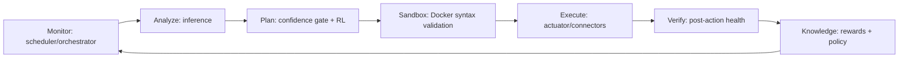
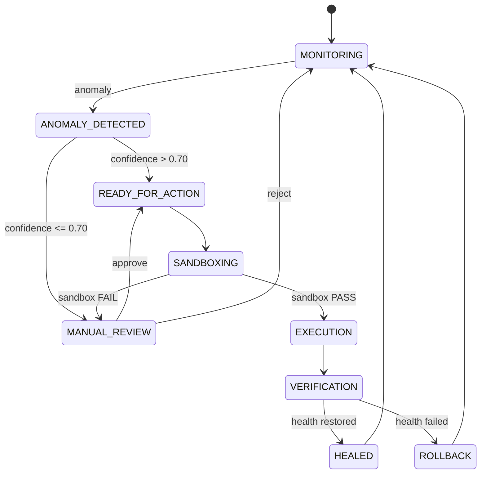

# NeuroSynapse Architecture

## Four logical tiers

1. **Presentation**: Vue/Vuetify dashboard in `frontend/`. It displays telemetry, incidents, XAI explanations, HITL controls, healing history, and downloadable incident logs.
2. **Intelligence**: `backend/ai_engine/` contains ensemble inference, rule-based safety classification, orchestration, XAI, and tabular epsilon-greedy Q-learning.
3. **Data**: Django ORM models in `backend/monitoring/models.py`, SQLite persistence, telemetry snapshots, incidents, healing actions, RL rewards, and policy state.
4. **Execution**: `backend/healing/actuator.py` validates remediation scripts in a network-disabled Docker sandbox before dispatching commands through connectors to simulators, PythonRouter, or FRR.

## MAPE-K flow

## Incident state machine

The implementation retains the project state names from Figure 3.2 and records healing actions and RL rewards for auditability.
